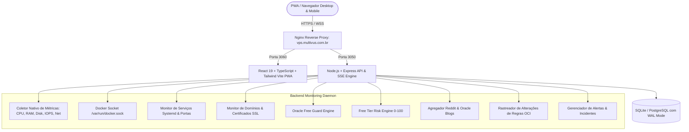

# VPS Multivus — Oracle Cloud Always Free Monitor 🚀

**VPS Multivus** é um sistema completo, moderno, funcional e responsivo de monitoramento em tempo real desenvolvido especificamente para instâncias **Oracle Cloud Infrastructure (OCI) Always Free** hospedadas no domínio principal `vps.multivus.com.br`.

---

## 🎯 Principais Objetivos

1. **Oracle Free Guard**: Proteção contra extrapolação de cotas do Oracle Always Free (4 OCPUs ARM Ampere A1, 24 GB RAM, 200 GB Storage, 10 TB Bandwidth, 1 IPv4 público).
2. **Reclamação por Ociosidade (Idle Policy Watch)**: Acompanhamento contínuo da regra da Oracle que desliga instâncias Always Free se a utilização de CPU, RAM e Rede no percentil 95 permanecer abaixo de 20% por 7 dias.
3. **Free Tier Risk Engine (Score 0–100)**: Diagnóstico automático de riscos com explicações práticas: *"O que aconteceu"*, *"Por que isso importa"* e *"O que fazer"*.
4. **Oracle Free Tier News & Reddit Aggregator**: Feed diário atualizado com discussões de capacidade de shapes ARM (Ampere A1), alertas de cobranças indevidas da comunidade e novidades oficiais.
5. **Rastreador de Mudanças (Rule Change Tracker)**: Comparação diária das regras atuais com snapshots anteriores, disparando alertas imediatos se houver alterações de políticas pela Oracle.
6. **Billing Protection**: Alertas em tiers (25%, 50%, 75%, 90%, 100% do Budget) e transparência financeira.
7. **Telemetria Completa da VPS**: CPU, RAM, Swap, Disco, IOPS, Network RX/TX, Load Average, Processos e gráficos interativos (1h, 6h, 24h, 7d, 30d).
8. **Docker & Serviços Linux**: Inspeção de containers em tempo real via `/var/run/docker.sock`, logs de containers, healthchecks e monitoramento de daemons systemd (Nginx, Docker, PostgreSQL, Redis, PM2, SSH, UFW, Fail2Ban).
9. **Monitor de Domínios & SSL**: Testes de HTTP 200, latência (ms), resolução DNS e contagem regressiva de expiração de certificados SSL com alertas em 30, 15, 7, 3 e 1 dias.
10. **Checkup Automático em 1 Clique**: 18 verificações de segurança e integridade com emissão de relatório completo.
11. **PWA (Progressive Web App)**: Totalmente responsivo, instalável em dispositivos móveis e desktops, com tema escuro profissional.

---

## 🏗️ Arquitetura do Sistema



---

## 📂 Estrutura de Pastas

```
ORACLE CONSUMO/
├── backend/
│   ├── src/
│   │   ├── config/             # Configurações e baseline Oracle Always Free
│   │   ├── database/           # SQLite em modo WAL com migrações automáticas
│   │   ├── middleware/         # JWT Auth, Rate Limiting, Helmet, Audit Logs
│   │   ├── routes/             # Rotas REST (/api/health, /api/metrics, /api/oracle, etc.)
│   │   ├── services/           # Regras de negócio, coletores, Docker e Risk Engine
│   │   ├── jobs/               # Cron jobs de telemetria, notícias e expurgo de dados
│   │   └── index.ts            # Servidor Express & SSE Streaming
│   ├── tests/                  # Testes automatizados Jest / Supertest
│   ├── Dockerfile              # Dockerfile de produção do backend
│   └── package.json
├── frontend/
│   ├── public/                 # Manifest PWA, Service Worker e Favicon SVG
│   ├── src/
│   │   ├── components/         # Free Guard, Risk Card, Gráficos, Docker, Serviços, Domínios
│   │   ├── context/            # AuthContext, MetricsContext (SSE), ThemeContext
│   │   ├── pages/              # Dashboard, Server, Docker, Services, Domains, Oracle, News, Alerts, Checkup, Settings, Login
│   │   ├── services/           # Cliente Axios tipado
│   │   ├── types/              # Definições TypeScript completas
│   │   └── index.css           # Design Tokens, Glassmorphism e Tailwind
│   ├── Dockerfile              # Dockerfile de produção Nginx Frontend
│   └── package.json
├── nginx/
│   └── vps.multivus.com.br.conf # Configuração Nginx com SSL Let's Encrypt e SSE
├── scripts/
│   ├── install.sh              # Instalação automática 1-clique
│   ├── update.sh               # Atualização segura com backup
│   ├── backup.sh               # Backup automático com rotação de 14 dias
│   ├── restore.sh              # Restauração de banco e dados
│   ├── healthcheck.sh          # Teste de integridade em linha de comando
│   └── deploy-to-vps.sh        # Deploy remoto via SSH para 147.15.19.44
├── docker-compose.yml          # Orquestração com limites de memória (<350MB total)
├── .env.example                # Modelo de variáveis de ambiente
└── README.md
```

---

## ⚙️ Limites Oficiais do Oracle Cloud Always Free

O **Oracle Free Guard** monitora ativamente as cotas oficiais documentadas pela Oracle:

| Recurso | Shape / Tipo | Limite Oficial Always Free |
| :--- | :--- | :--- |
| **Processador ARM** | `VM.Standard.A1.Flex` | **4 OCPUs** (3.000 OCPU-horas/mês) |
| **Memória RAM ARM** | `VM.Standard.A1.Flex` | **24 GB RAM** (18.000 GB-horas/mês) |
| **Instâncias AMD** | `VM.Standard.E2.1.Micro` | **2 Instâncias** (1/8 OCPU, 1 GB RAM cada) |
| **Armazenamento** | Boot + Block Volumes | **200 GB Total** combinados |
| **Tráfego de Saída** | Egress para Internet | **10 TB / mês** gratuitos |
| **IPs Públicos** | IPv4 Efêmero | **1 IP por instância ativa** |
| **Load Balancer** | Flexível | **1 Instância (10 Mbps)** |

> [!IMPORTANT]
> **Política de Reclamação por Ociosidade da Oracle**
> Instâncias Always Free com utilização de CPU, RAM e Rede abaixo do percentil 95 de 20% durante 7 dias consecutivos podem ser identificadas como ociosas e desligadas ou recuperadas pela Oracle. O sistema calcula esse percentil e emite avisos preventivos.

---

## 🚀 Como Instalar e Executar

### 1. Requisitos
- Linux (Ubuntu 22.04 / 24.04 recomendados) ou arquitetura ARM64 / x86_64
- Docker Engine e Docker Compose
- Nginx com Certbot para terminação SSL

### 2. Execução Local com Docker Compose

```bash
# 1. Clone ou acesse o repositório
cd "ORACLE CONSUMO"

# 2. Configure o arquivo .env
cp .env.example .env

# 3. Inicie os containers
docker compose up -d

# 4. Verifique o status
docker compose ps
docker compose logs -f
```

O backend estará em `http://localhost:3050` e o frontend em `http://localhost:3060`.

### 3. Deploy Remoto na VPS Oracle (`147.15.19.44`)

Execute o script de implantação remota:

```bash
bash scripts/deploy-to-vps.sh
```

---

## 🔒 Credenciais de Acesso Padrão

- **URL do Painel:** `https://vps.multivus.com.br`
- **Usuário Inicial:** `admin`
- **Senha Inicial:** `Systemzap@2025`

*(A senha pode ser alterada a qualquer momento na aba **Configurações**).*

---

## 🛠️ Comandos Úteis de Operação

| Comando | Descrição |
| :--- | :--- |
| `docker compose up -d` | Inicia todos os serviços em segundo plano |
| `docker compose down` | Para e remove os containers |
| `docker compose logs -f` | Acompanha os logs em tempo real |
| `bash scripts/healthcheck.sh` | Executa verificação de saúde via terminal |
| `bash scripts/backup.sh` | Gera backup manual do banco e configurações |
| `bash scripts/restore.sh <arquivo.tar.gz>` | Restaura backup especificado |
| `bash scripts/update.sh` | Atualiza o painel com segurança |

---

## 🧪 Testes Automatizados

O sistema inclui uma suíte completa de testes automatizados:

```bash
cd backend
npm test
```

Testes cobertos:
- ✅ **API Health & Auth Flow** (Login, JWT, verificação de senha)
- ✅ **Métricas do Servidor** (Telemetria nativa, histórico e sumarização)
- ✅ **Oracle Rules & Free Guard** (Cálculo de limites vs uso e política de ociosidade)
- ✅ **Free Tier Risk Engine** (Cálculo do Risk Score 0–100 e fatores de risco)
- ✅ **Checkup Automático** (18 verificações diagnósticas completas)
- ✅ **Agregador de Notícias & Reddit** (Filtros, deduplicação e avisos comunitários)
